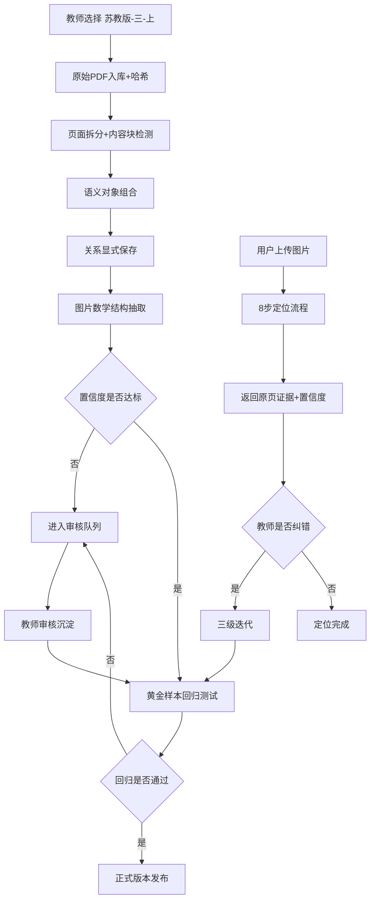

# 新版苏教版小学数学三年级上册教材数字化解析与例题练习识别系统 — 产品需求文档（PRD）

## 1. 产品概述

本系统是"AI助力教师备课"项目的**教材基础层**，专用于新版苏教版小学数学三年级上册的完整数字化、结构化解析与原文定位。面向教研员、教师与教材数字化工程师，提供从教材入库、对象识别、数学结构抽取到人机协同纠错的完整工作流，所有结果可回溯至原PDF页与精确页面区域。

- 严格限定：仅处理"苏教版—三年级—上册"，禁止擅自扩展版本；禁止课时划分、教学设计、学情分析、核心素养与课程标准映射。
- 价值：为后续备课、课时设计等上层应用提供**可审计、可回滚、可回归测试**的结构化教材事实库。

## 2. 核心功能

### 2.1 用户角色

| 角色 | 进入方式 | 核心权限 |
|------|---------------------|------------------|
| 教师用户 | 主动选择"苏教版—三年级—上册"进入 | 浏览教材对象、上传图片定位、纠错录入、审核队列处理 |
| 教研管理员 | 授权登录 | 资源库维护、版本发布、黄金样本管理、回归测试 |
| 工程审核 | 授权登录 | 查看规范、ER设计、字段字典、完成情况审计 |

### 2.2 功能模块（页面级）

1. **工作台**：教材锁定状态、五阶段进度、关键验收指标、快速入口
2. **教材标准库**：五层数字模型、教材元数据、目录结构、PDF页/印刷页浏览
3. **页面与内容块**：内容块可视化、坐标体系（标准/归一化/多边形）、阅读顺序
4. **图标资源库**：例题书本图标、栏目图标、变体自动生成、录入与匹配
5. **角色资源库**：青椒/蘑菇/番茄/白菜/豌豆/茄子、身份与话语功能分离、姿态管理
6. **例题识别**：书本图标锚点检出、例题对象封装、组成元素、跨页延续
7. **练习识别**：试一试/想想做做/练习、大题→小题→题组层级、共用材料归属
8. **图片数学结构**：数量关系图、表格与统计图、空间与几何图结构抽取
9. **上传定位**：上传图片、8步定位流程、坐标配准、置信度展示
10. **纠错与版本**：三级迭代、纠错记录、版本回滚、审计链
11. **审核队列**：低置信度项、人工审核界面、沉淀确认
12. **黄金样本与回归**：15类样本集、15项验收指标、回归测试结果
13. **规范文档中心**：19项交付物（ER图、字段字典、坐标规范、识别规则等）
14. **完成情况**：当前阶段、遗留问题、下一步建议

### 2.3 页面详情

| 页面名称 | 模块名称 | 功能描述 |
|-----------|-------------|---------------------|
| 工作台 | 教材锁定卡 | 显示"苏教版—三—上"锁定状态，禁止切换版本提示 |
| 工作台 | 阶段进度 | 10阶段执行顺序与当前阶段标识 |
| 工作台 | 关键指标卡 | 例题锚点检出率、对象完整率、图片归属准确率等 |
| 教材标准库 | 五层数字模型 | 原始证据/内容块/语义对象/关系/数学结构层说明 |
| 教材标准库 | 元数据卡 | 版本、年级、册次、版次、文件哈希、页数 |
| 教材标准库 | 目录树 | 单元→栏目→例题/练习导航 |
| 教材标准库 | 页面浏览器 | PDF页码↔印刷页码、页面图预览、区域标注叠加 |
| 页面与内容块 | 内容块列表 | 按阅读顺序展示类型/原始文/规范化文/置信度/审核状态 |
| 页面与内容块 | 坐标面板 | 标准像素坐标、归一化坐标、多边形顶点 |
| 图标资源库 | 图标网格 | 例题书本图标、试一试/想想做做图标等 |
| 图标资源库 | 变体生成 | 灰度/二值/多尺度/模糊/JPEG/亮度/裁剪/截图质量 |
| 图标资源库 | 录入表单 | 名称/类型/教材语义/默认角色/适用范围 |
| 角色资源库 | 角色卡 | 6角色头像、身份（学生/教师）、教材姿态 |
| 角色资源库 | 身份-话语分离 | 角色身份与当前话语功能分开保存 |
| 例题识别 | 锚点检出 | 书本图标+数字强锚点，例1/例2…边界判断 |
| 例题识别 | 对象封装 | 情境图/已知条件/问题/方法/算式/追问/结论/答句 |
| 练习识别 | 层级树 | 栏目→题组→大题→小题→组成部分 |
| 练习识别 | 共用材料 | 共用题干/图片/表格/统计图、跨页延续 |
| 图片数学结构 | 数量关系 | 数学对象/数量/单位/已知未知/每份数份数总数/加减乘除/比较倍总分 |
| 图片数学结构 | 表格统计图 | 行列标题/数据单元格/空白含义/图表类型/轴/刻度/每格代表 |
| 图片数学结构 | 几何图 | 点线面/边角顶点/长度角度/平行垂直相等对称/拼合分割/平移旋转轴对称 |
| 上传定位 | 上传区 | 拖拽上传完整页/半页/局部/手机倾斜/黑白打印 |
| 上传定位 | 8步流程 | 类型判断→特征提取→召回→重排→配准→映射→返回→证据展示 |
| 纠错与版本 | 纠错记录 | 页面区域/原结果/修改结果/错误类型/规则版本/置信度/修改人/时间 |
| 纠错与版本 | 三级迭代 | 即时修正/资源库更新/正式升级 |
| 纠错与版本 | 版本时间线 | 版本号/审计/回滚/旧结果保留 |
| 审核队列 | 待审列表 | 新图标/角色冲突/气泡绑定不清/多题归属/跨页/空白含义/数字刻度 |
| 审核队列 | 审核界面 | 原页证据并排、确认/驳回、沉淀到资源库与回归集 |
| 黄金样本与回归 | 样本集 | 15类覆盖样本（例题图标→手机拍摄透视） |
| 黄金样本与回归 | 验收指标 | 15项指标当前值与目标值 |
| 黄金样本与回归 | 回归结果 | 测试用例、通过率、失败明细 |
| 规范文档中心 | 19项交付物 | 目录结构/ER/字段字典/坐标规范/识别规则/结构规范等 |
| 完成情况 | 阶段状态 | 已完成/进行中/未开始 |
| 完成情况 | 遗留问题 | 待解决项与风险 |
| 完成情况 | 下一步建议 | 下一阶段优先级 |

## 3. 核心流程

### 3.1 教材入库与建库流程

教师选择"苏教版—三年级—上册"→系统校验版本锁定→原始PDF入库（哈希+元数据）→逐页拆分高清页面图→内容块检测（带坐标）→语义对象组合（例题/试一试/想想做做/练习）→关系显式保存→图片数学结构抽取→低置信度入审核队列→黄金样本回归测试→正式版本发布。

### 3.2 用户上传图片原文定位流程

用户上传（完整页/半页/局部/手机倾斜/黑白）→类型判断→提取文字/数字/算式/图标/角色/结构特征→在苏教版三上标准库召回候选页或对象→综合视觉指纹/OCR/算式/图标/布局重排→对高概率候选做页面或局部配准→映射到标准教材坐标→返回版本/年级册次/单元/PDF页/印刷页/栏目/例题或练习/大题小题号→展示原页证据、匹配区域与置信度。

### 3.3 人机协同纠错流程

发现错误（教师反馈或低置信度）→记录纠错（页面区域/原结果/修改结果/错误类型/规则版本/模型版本/原置信度/修改人/时间/适用范围/是否通用样本）→即时修正（同教材同对象立即复用）/资源库更新（新图标变体/新角色姿态/新反例/新边界规则）/正式升级（积累样本+黄金样本回归通过后发布）→版本号/审计/可回滚/旧结果保留。

## 4. 用户界面设计

### 4.1 设计风格

- **主色**：宣纸暖白底（#FAF7F0）+ 墨黑正文（#1F1B16）+ 朱砂红强调（#B33A3A，印章意象）+ 墨青辅助（#3A5A5A，数据与图表）
- **次级色**：米黄分隔（#E8E0D0）、淡墨灰（#6B6258）、印章暗红（#8B2C2C）
- **按钮风格**：方角微圆（2px）、墨线描边为主、朱砂红实心按钮用于主操作
- **字体**：标题 Noto Serif SC（思源宋体，编辑/学术感）；正文 Noto Sans SC（思源黑体）；数据/代码 JetBrains Mono
- **布局**：编辑型栅格（12列）、编号章节、不对称构图、教材页眉竖排点缀
- **图标**：lucide-react 线性图标，与墨线风格统一
- **文化意象**：印章徽记、章节编号、竖排标题点缀、教材页码感

### 4.2 页面设计概览

| 页面名称 | 模块名称 | UI 元素 |
|-----------|-------------|-------------|
| 工作台 | 教材锁定卡 | 印章式锁定徽记、朱砂边框、版本不可切换提示 |
| 工作台 | 阶段进度 | 编号时间线、当前阶段墨青高亮 |
| 工作台 | 指标卡 | 大号宋体数字、目标值对照、墨青进度条 |
| 教材标准库 | 五层模型 | 五列卡片纵向层叠、箭头连接 |
| 教材标准库 | 目录树 | 竖排缩进、墨线连接、单元编号 |
| 教材标准库 | 页面浏览器 | 双栏（PDF页↔印刷页）、区域叠加层 |
| 页面与内容块 | 坐标面板 | 网格背景、多边形顶点标记、归一化数值 |
| 图标资源库 | 变体网格 | 8宫格变体预览、参数标签 |
| 角色资源库 | 角色卡 | 圆角头像、身份色块（学生墨青/教师朱砂） |
| 例题识别 | 对象封装 | 中心例题卡+环绕组成元素 |
| 练习识别 | 层级树 | 缩进树形、共用材料虚线连接 |
| 图片数学结构 | 结构抽取 | 原图+结构化字段并排 |
| 上传定位 | 8步流程 | 步骤条+证据并排+置信度仪表 |
| 纠错与版本 | 时间线 | 竖向版本轴、回滚节点 |
| 审核队列 | 审核界面 | 三栏（待审/原页证据/操作） |
| 黄金样本与回归 | 指标表 | 15项指标条形图、通过率环图 |
| 规范文档中心 | 文档列表 | 编号目录、Mermaid图、字段字典表 |
| 完成情况 | 状态看板 | 阶段状态色块、遗留问题清单 |

### 4.3 响应式

Desktop-first，1280px+ 为主优化断点；1024–1279px 适配（侧栏折叠为图标）；平板 768px+ 基本可用；移动端仅工作台与上传定位提供基础可用版本。教材浏览、ER设计、字段字典等重数据页面以桌面端为准。

### 4.4 3D 场景

不适用。本系统为数据与文档密集型管理界面，无 3D 场景需求。
