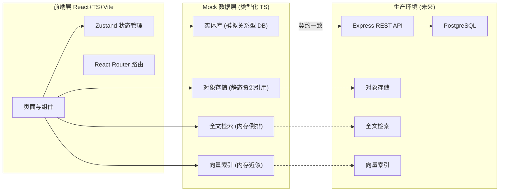
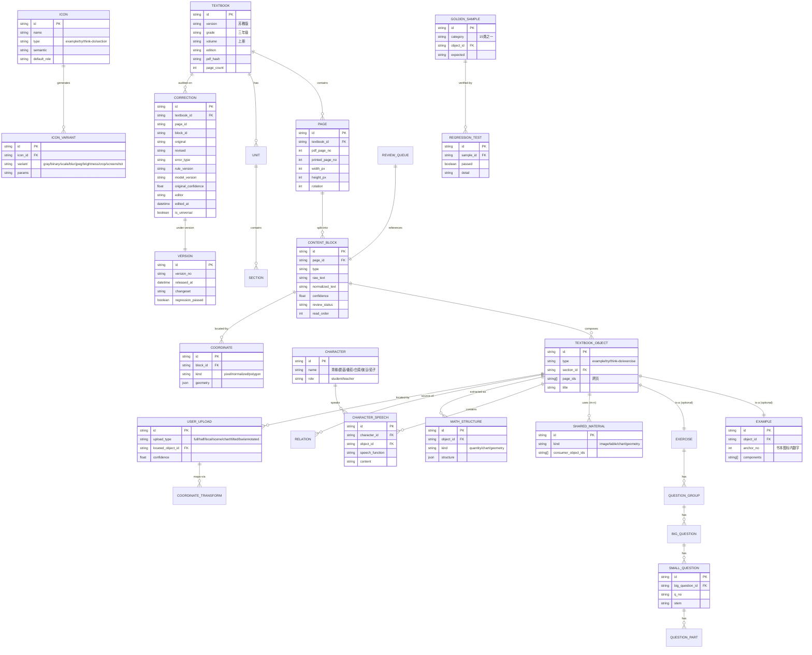

# 新版苏教版小学数学三年级上册教材数字化解析与例题练习识别系统 — 技术架构文档

## 1. 架构设计

当前阶段为**前端原型**，使用类型化 TypeScript mock 数据层严格模拟关系型数据库结构（对应下方 ER 设计），所有实体、字段、关系与生产环境一致。生产环境将迁移至 Express + PostgreSQL + 对象存储 + 全文检索 + 向量索引，前端 API 契约保持不变。



## 2. 技术描述

- **前端**：React@18 + TypeScript + Vite + TailwindCSS@3 + Zustand + React Router v6
- **初始化工具**：vite-init（react-ts 模板）
- **后端**：当前无（前端原型，mock 数据层模拟）；生产规划 Express@4 + TypeScript
- **数据库**：当前类型化 TS mock（严格对应 ER）；生产规划 PostgreSQL（主数据）+ 对象存储（PDF/页面图/区域图/上传图/变体）+ 全文检索（教材原文/题干/话语/算式）+ 向量索引（仅辅助定位）
- **图表**：Mermaid（ER 图、流程图，纯静态渲染）
- **图标**：lucide-react
- **字体**：Noto Serif SC / Noto Sans SC / JetBrains Mono（Google Fonts）

### 数据存储原则（来自规范）

- 正式主数据**不得**只存在向量库或 Markdown 中
- 向量索引**只作辅助**（页面/区域定位、题目语义、数量关系、数据结构、几何关系描述向量）
- 任何无法确认的内容**标记不确定**并进入人工审核，不得猜测填充
- 原始 PDF 不得被修改或覆盖；派生图不得作为新的人工真值

## 3. 路由定义

| 路由 | 页面 | 用途 |
|-------|---------|---------|
| `/` | 工作台 | 教材锁定、阶段进度、关键指标、快速入口 |
| `/library` | 教材标准库 | 五层数字模型、元数据、目录树、页面浏览 |
| `/library/page/:pageId` | 页面与内容块 | 内容块可视化、坐标体系 |
| `/icons` | 图标资源库 | 例题/栏目图标、变体生成、录入 |
| `/characters` | 角色资源库 | 6角色、身份-话语分离、姿态 |
| `/examples` | 例题识别 | 锚点检出、对象封装、组成元素 |
| `/exercises` | 练习识别 | 试一试/想想做做/练习、层级、共用材料 |
| `/math-structure` | 图片数学结构 | 数量关系/表格统计图/几何图 |
| `/locate` | 上传定位 | 上传图片、8步流程、配准、置信度 |
| `/corrections` | 纠错与版本 | 三级迭代、纠错记录、版本回滚 |
| `/review` | 审核队列 | 低置信度项、人工审核界面 |
| `/golden-samples` | 黄金样本与回归 | 样本集、验收指标、回归结果 |
| `/specs` | 规范文档中心 | 19项交付物（ER/字段字典/坐标/规则等） |
| `/status` | 完成情况 | 阶段状态、遗留问题、下一步 |

## 4. API 定义

当前为前端 mock，无真实 API。生产环境契约（预留）：

```typescript
// 教材对象查询
GET /api/textbooks/:version/objects?type=example&unit=1
// 上传图片定位
POST /api/locate  { uploadId: string, scope: { version, grade, volume } }
// 纠错提交
POST /api/corrections { pageId, blockId, original, revised, errorType, ruleVersion }
// 资源库录入
POST /api/icons { name, type, semantic, defaultRole, scope, imageData }
// 版本发布
POST /api/versions/release { version, changeset, regressionResult }
```

## 5. 服务端架构图

当前无后端。生产规划：

```mermaid
flowchart TD
    C["Controller"] --> S["Service"]
    S --> R["Repository"]
    R --> PG[("PostgreSQL")]
    S --> OS["对象存储客户端"]
    OS --> OSS[("MinIO/OSS")]
    S --> ES[("全文检索")]
    S --> VDB[("向量索引")]
```



## 6. 数据模型

### 6.1 数据模型定义（ER 图）



### 6.2 数据定义语言（DDL 摘要，PostgreSQL 风格）

```sql
CREATE TABLE textbook (
  id TEXT PRIMARY KEY,
  version TEXT NOT NULL,        -- '苏教版'
  grade TEXT NOT NULL,         -- '三年级'
  volume TEXT NOT NULL,        -- '上册'
  edition TEXT NOT NULL,
  pdf_hash TEXT NOT NULL UNIQUE,
  page_count INT NOT NULL,
  created_at TIMESTAMPTZ DEFAULT now()
);

CREATE TABLE page (
  id TEXT PRIMARY KEY,
  textbook_id TEXT NOT NULL REFERENCES textbook(id),
  pdf_page_no INT NOT NULL,
  printed_page_no INT,
  width_px INT NOT NULL,
  height_px INT NOT NULL,
  rotation INT DEFAULT 0,
  UNIQUE(textbook_id, pdf_page_no)
);

CREATE TABLE content_block (
  id TEXT PRIMARY KEY,
  page_id TEXT NOT NULL REFERENCES page(id),
  type TEXT NOT NULL,          -- title/text/q_no/example_icon/section_icon/scene/table/chart/geometry/formula/character/speech_box/answer_blank/decoration
  raw_text TEXT,
  normalized_text TEXT,
  confidence REAL DEFAULT 0.0,
  review_status TEXT DEFAULT 'pending',  -- pending/confirmed/rejected
  read_order INT DEFAULT 0
);

CREATE TABLE textbook_object (
  id TEXT PRIMARY KEY,
  type TEXT NOT NULL,          -- example/try/think-do/exercise
  section_id TEXT,
  page_ids TEXT[] NOT NULL,     -- 支持跨页
  title TEXT
);

CREATE TABLE example (
  id TEXT PRIMARY KEY,
  object_id TEXT NOT NULL REFERENCES textbook_object(id),
  anchor_no INT NOT NULL,      -- 书本图标内数字
  components TEXT[] NOT NULL    -- 情境图/已知条件/问题/方法/算式/追问/结论/答句
);

CREATE TABLE exercise (
  id TEXT PRIMARY KEY,
  object_id TEXT NOT NULL REFERENCES textbook_object(id),
  section_type TEXT NOT NULL   -- try/think-do/practice
);

CREATE TABLE question_group (
  id TEXT PRIMARY KEY,
  exercise_id TEXT NOT NULL REFERENCES exercise(id)
);

CREATE TABLE big_question (
  id TEXT PRIMARY KEY,
  group_id TEXT REFERENCES question_group(id),
  exercise_id TEXT NOT NULL REFERENCES exercise(id),
  q_no TEXT NOT NULL
);

CREATE TABLE small_question (
  id TEXT PRIMARY KEY,
  big_question_id TEXT NOT NULL REFERENCES big_question(id),
  q_no TEXT,
  stem TEXT
);

CREATE TABLE shared_material (
  id TEXT PRIMARY KEY,
  kind TEXT NOT NULL,          -- image/table/chart/geometry
  consumer_object_ids TEXT[] NOT NULL
);

CREATE TABLE character (
  id TEXT PRIMARY KEY,
  name TEXT NOT NULL,          -- 青椒/蘑菇/番茄/白菜/豌豆/茄子
  role TEXT NOT NULL           -- student/teacher
);

CREATE TABLE character_speech (
  id TEXT PRIMARY KEY,
  character_id TEXT NOT NULL REFERENCES character(id),
  object_id TEXT NOT NULL REFERENCES textbook_object(id),
  speech_function TEXT NOT NULL,  -- 与角色身份分开保存
  content TEXT NOT NULL
);

CREATE TABLE icon (
  id TEXT PRIMARY KEY,
  name TEXT NOT NULL,
  type TEXT NOT NULL,          -- example/try/think-do/section
  semantic TEXT,
  default_role TEXT
);

CREATE TABLE icon_variant (
  id TEXT PRIMARY KEY,
  icon_id TEXT NOT NULL REFERENCES icon(id),
  variant TEXT NOT NULL,      -- gray/binary/scale/blur/jpeg/brightness/crop/screenshot
  params JSONB,
  source_icon_id TEXT NOT NULL REFERENCES icon(id),
  for_training BOOLEAN DEFAULT FALSE,
  for_match BOOLEAN DEFAULT TRUE,
  for_test BOOLEAN DEFAULT FALSE
);

CREATE TABLE coordinate (
  id TEXT PRIMARY KEY,
  block_id TEXT NOT NULL REFERENCES content_block(id),
  kind TEXT NOT NULL,          -- pixel/normalized/polygon
  geometry JSONB NOT NULL      -- {x,y,w,h} / {nx,ny,nw,nh} / {points:[[x,y]...]}
);

CREATE TABLE math_structure (
  id TEXT PRIMARY KEY,
  object_id TEXT NOT NULL REFERENCES textbook_object(id),
  kind TEXT NOT NULL,          -- quantity/chart/geometry
  structure JSONB NOT NULL
);

CREATE TABLE relation (
  id TEXT PRIMARY KEY,
  src_object_id TEXT NOT NULL REFERENCES textbook_object(id),
  rel_type TEXT NOT NULL,      -- icon-marks/scene-provides/character-says/explains-formula/shared-table/spans-page/try-follows-example
  dst_object_id TEXT REFERENCES textbook_object(id),
  dst_block_id TEXT REFERENCES content_block(id)
);

CREATE TABLE correction (
  id TEXT PRIMARY KEY,
  textbook_id TEXT NOT NULL REFERENCES textbook(id),
  page_id TEXT REFERENCES page(id),
  block_id TEXT REFERENCES content_block(id),
  original TEXT,
  revised TEXT NOT NULL,
  error_type TEXT,
  rule_version TEXT,
  model_version TEXT,
  original_confidence REAL,
  editor TEXT NOT NULL,
  edited_at TIMESTAMPTZ DEFAULT now(),
  is_universal BOOLEAN DEFAULT FALSE
);

CREATE TABLE version (
  id TEXT PRIMARY KEY,
  version_no TEXT NOT NULL UNIQUE,
  released_at TIMESTAMPTZ DEFAULT now(),
  changeset JSONB,
  regression_passed BOOLEAN DEFAULT FALSE
);

CREATE TABLE review_task (
  id TEXT PRIMARY KEY,
  block_id TEXT NOT NULL REFERENCES content_block(id),
  reason TEXT NOT NULL,        -- new-icon/role-conflict/bubble-unclear/multi-owner/span-page/blank-ambiguous/scale-unclear/no-vs-example/parse-conflict/multi-candidate
  priority INT DEFAULT 5,
  status TEXT DEFAULT 'pending'
);

CREATE TABLE golden_sample (
  id TEXT PRIMARY KEY,
  category TEXT NOT NULL,      -- 15类之一
  object_id TEXT REFERENCES textbook_object(id),
  expected JSONB NOT NULL
);

CREATE TABLE regression_test (
  id TEXT PRIMARY KEY,
  sample_id TEXT NOT NULL REFERENCES golden_sample(id),
  passed BOOLEAN NOT NULL,
  detail TEXT,
  ran_at TIMESTAMPTZ DEFAULT now()
);

CREATE TABLE user_upload (
  id TEXT PRIMARY KEY,
  upload_type TEXT NOT NULL,   -- full/half/local/scene/chart/tilted/bw/annotated
  located_object_id TEXT REFERENCES textbook_object(id),
  located_page_id TEXT REFERENCES page(id),
  confidence REAL,
  uploaded_at TIMESTAMPTZ DEFAULT now()
);

CREATE TABLE coordinate_transform (
  id TEXT PRIMARY KEY,
  upload_id TEXT NOT NULL REFERENCES user_upload(id),
  transform_kind TEXT NOT NULL,  -- similarity/homography/local-grid
  matrix JSONB,                   -- 3x3 单应矩阵或局部变换参数
  residual REAL                   -- 配准残差
);

CREATE INDEX idx_block_page ON content_block(page_id);
CREATE INDEX idx_object_section ON textbook_object(section_id);
CREATE INDEX idx_correction_textbook ON correction(textbook_id);
CREATE INDEX idx_review_status ON review_task(status);
```

### 字段字典要点

- `confidence`：REAL ∈ [0,1]，低于阈值（默认 0.8）进入审核队列
- `review_status`：pending/confirmed/rejected，仅 confirmed 进入正式库
- `page_ids[]`：数组类型，支持跨页对象
- `character.role` 与 `character_speech.speech_function` **分开存储**，符合规范第四节
- `icon_variant.source_icon_id`：所有派生图必须记录来源原图
- `math_structure.kind`：quantity（数量关系）/ chart（表格统计图）/ geometry（空间几何）
- `relation.rel_type`：显式关系，不依赖空间距离隐式推断
- `coordinate.kind`：pixel（标准页像素）/ normalized（0–1）/ polygon（多边形）
- `coordinate_transform.transform_kind`：similarity（缩放旋转）/ homography（透视）/ local-grid（弯曲）
